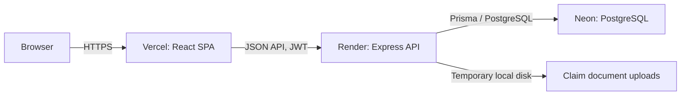
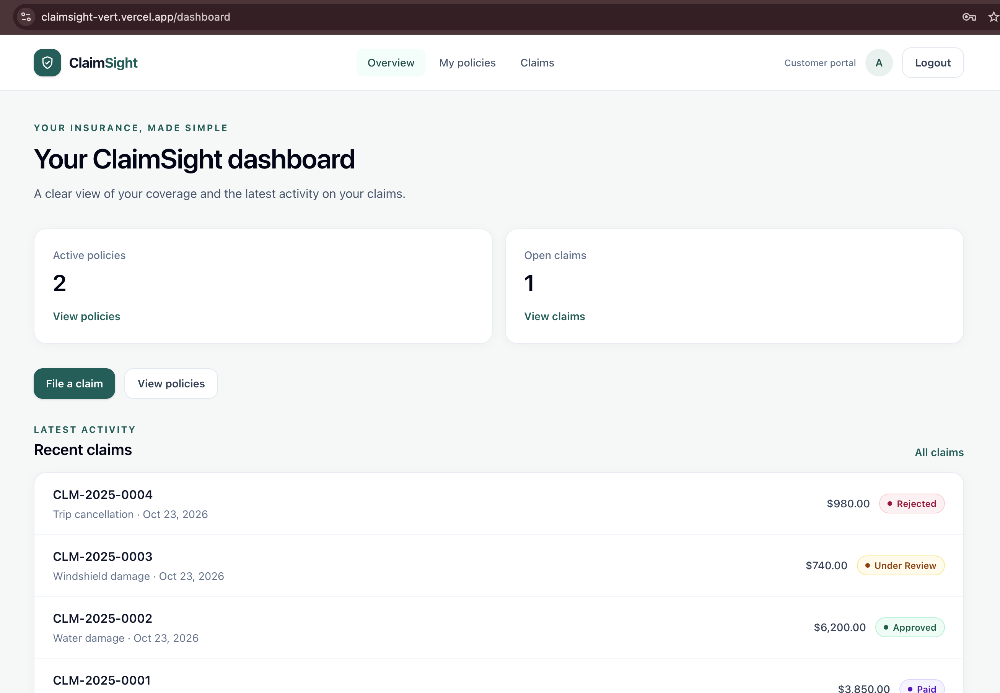
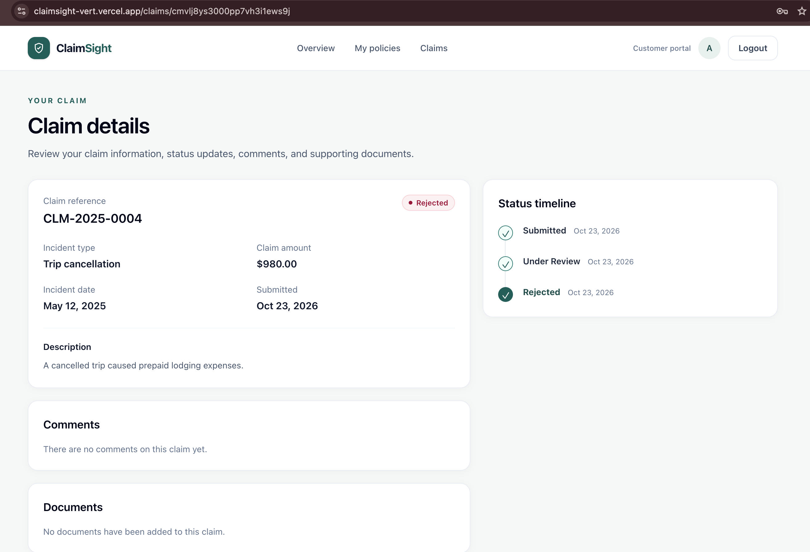
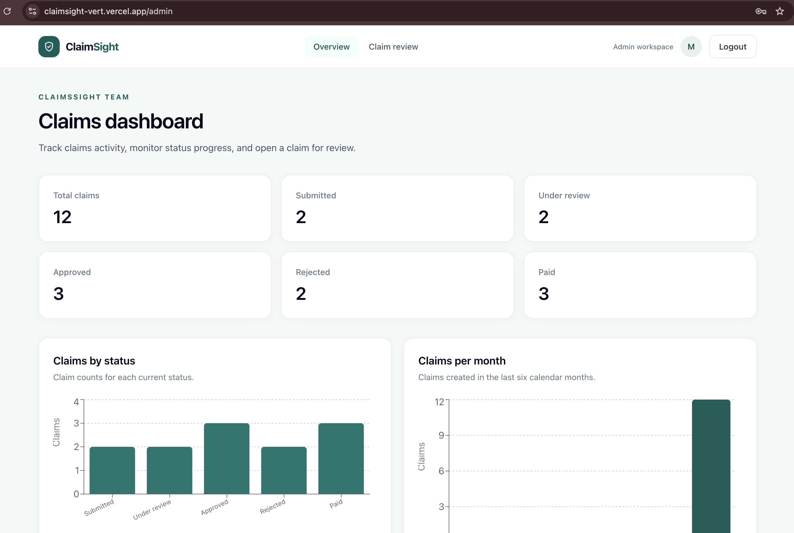

# ClaimSight

ClaimSight is a full-stack insurance policy and claims portal where fictional customers can review coverage, file and track claims, and share supporting documents while administrators review claims, update statuses, and communicate with customers.

## Live demo

[Open the live ClaimSight demo](https://claimsight-vert.vercel.app)

The API runs on a free tier and sleeps when idle, so the first load can take up to a minute. Use the "Try as customer" or "Try as admin" buttons on the login page.

### Demo logins

| Role     | Email                       | Password           |
| -------- | --------------------------- | ------------------ |
| Customer | `avery.brooks@example.test` | `CustomerDemo123!` |
| Admin    | `admin@claimsight.local`    | `AdminDemo123!`    |

All records and people in the demo are fictional. These credentials are public demo accounts; do not use them for real or sensitive information.

## Features

- Customer registration and sign-in with role-based access.
- Customer dashboards for policies and claims.
- Claim submission with PDF, JPG, or PNG supporting documents.
- Claim status timeline and claim comments.
- Admin dashboard charts, claim search and filters, status updates, and comments.
- Authenticated document downloads with a clear response when a file is no longer on disk.
- Responsive React interface with loading, empty, and error states.

## Tech stack

- **Client:** React 18, TypeScript, Vite, React Router, TanStack Query, React Hook Form, Zod, Tailwind CSS, Recharts.
- **Server:** Node.js, Express, TypeScript, Prisma 7, PostgreSQL, JWT, bcrypt, Zod.
- **Hosting:** Vercel (client), Render (server), and Neon (managed PostgreSQL).
- **Local containers:** Docker Compose and PostgreSQL.

## Architecture



## Run locally

Requirements: Node.js 20.19+ and npm. For Docker, also install Docker with Compose.

### With Docker

1. Copy the root environment example and set unique local values:

   ```sh
   cp .env.example .env
   ```

   Use a URL-safe `POSTGRES_PASSWORD`, because Compose includes it in the API's PostgreSQL connection string.

2. Start the database, API, and client:

   ```sh
   docker compose up --build
   ```

3. Open the client at `http://localhost:8080`. The API health endpoint is `http://localhost:3000/health`.

Demo data is not loaded automatically. To load it into the local database, run:

```sh
docker compose exec server npm run prisma:seed
```

Stop the services with `docker compose down`. Use `docker compose down --volumes` only when you also intend to remove the local database and upload volumes.

### Without Docker

1. Start a local PostgreSQL instance.
2. Copy the server and client environment examples, then set the database connection and local API URL:

   ```sh
   cp server/.env.example server/.env
   cp client/.env.example client/.env
   ```

3. Install dependencies and prepare the database:

   ```sh
   cd server && npm ci
   npm run prisma:migrate -- --name init
   npm run prisma:seed
   ```

4. In one terminal, start the API:

   ```sh
   cd server && npm run dev
   ```

5. In another terminal, start the client:

   ```sh
   cd client && npm ci && npm run dev
   ```

The client runs at `http://localhost:5173`; the API health endpoint is `http://localhost:3000/health`. The local server environment must allow the client origin with `CLIENT_ORIGIN`.

## API overview

All application endpoints are prefixed by `/api`. Protected routes require a bearer token from login or registration.

| Method        | Endpoint                                           | Description                                  |
| ------------- | -------------------------------------------------- | -------------------------------------------- |
| `POST`        | `/api/auth/register`                               | Register a customer account                  |
| `POST`        | `/api/auth/login`                                  | Sign in                                      |
| `GET`         | `/api/auth/me`                                     | Get the signed-in user                       |
| `GET`         | `/api/policies`                                    | List the signed-in customer's policies       |
| `GET`         | `/api/policies/:id`                                | Get a policy owned by the signed-in customer |
| `GET`, `POST` | `/api/claims`                                      | List claims or submit a claim                |
| `GET`         | `/api/claims/:id`                                  | Get a claim owned by the signed-in customer  |
| `POST`        | `/api/claims/:id/documents`                        | Upload a claim document                      |
| `GET`         | `/api/claims/:claimId/documents/:documentId`       | Download a claim document                    |
| `GET`         | `/api/admin/claims`                                | List and filter claims (admin)               |
| `GET`         | `/api/admin/claims/:id`                            | Get claim details (admin)                    |
| `GET`         | `/api/admin/claims/:claimId/documents/:documentId` | Download a claim document (admin)            |
| `PATCH`       | `/api/admin/claims/:id/status`                     | Update a claim status (admin)                |
| `POST`        | `/api/admin/claims/:id/comments`                   | Add a claim comment (admin)                  |
| `GET`         | `/api/admin/stats`                                 | Get dashboard statistics (admin)             |
| `GET`         | `/health`                                          | Check API and database availability          |

## Environment variable reference

The names below are configured through environment files for local work and hosting-provider settings for deployment. Do not commit real credentials.

| Component      | Variable names                                                                                      |
| -------------- | --------------------------------------------------------------------------------------------------- |
| Server         | `NODE_ENV`, `PORT`, `DATABASE_URL`, `JWT_SECRET`, `JWT_EXPIRES_IN`, `CLIENT_ORIGIN`                 |
| Client         | `VITE_API_URL`                                                                                      |
| Docker Compose | `POSTGRES_DB`, `POSTGRES_USER`, `POSTGRES_PASSWORD`, `JWT_SECRET`, `JWT_EXPIRES_IN`, `VITE_API_URL` |

## Known limitations

- Free Render services may sleep while idle. The first request after sleep can take up to a minute.
- Uploaded files are stored on the server's local disk and are not persistent on free hosting. A deployment or restart may remove files; their database records remain and downloading a missing file returns 404.
- All demo data, policies, claims, people, and credentials are fictional.

## Future improvements

- Move claim documents to durable object storage.
- Add a policy-question assistant with answers grounded in policy documents.
- Add automated deployment previews and production monitoring.
- Add more end-to-end coverage for customer and administrator workflows.
- Expand reporting, accessibility audits, and operational dashboards.

## Screenshots

### Customer dashboard



### Claim details



### Admin dashboard



## Deployment

For Render, use the build command `npm ci --include=dev && npm run build`; `--include=dev` installs the `@types/*` packages required by the TypeScript build when `NODE_ENV=production`. See [docs/DEPLOYMENT.md](docs/DEPLOYMENT.md) for the step-by-step Neon, Render, and Vercel deployment guide, including the manual production demo-data seed procedure.
